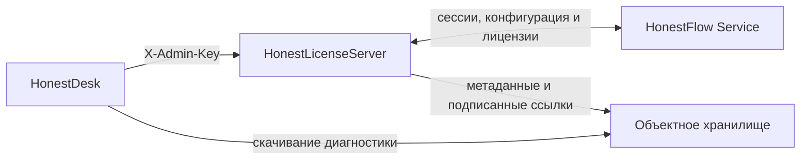

# HonestDesk

HonestDesk — доверенное WPF-приложение оператора для управления клиентами и устройствами HonestFlow через [HonestLicenseServer](https://github.com/1Yoda1/HonestLicenseServer). Это не клиент кассового рабочего места: оно используется сотрудниками поддержки и администраторами.

## Возможности

- создание и редактирование клиентов;
- просмотр, создание, редактирование, отключение, удаление, восстановление и высвобождение устройств;
- обработка заявок на регистрацию: просмотр адреса, версии HonestFlow, одобрение или отклонение с комментарием;
- выпуск, публикация, просмотр истории и отзыв персональных подписанных лицензий;
- настройка идентификационного кода, токена ЧЗ, параметров RuDesktop, версий компонентов и политик лицензирования;
- просмотр обращений в поддержку, получение данных согласованного удалённого доступа и отметка «Выполнено»;
- отдельный раздел диагностических архивов: уведомление о новом архиве, отправитель и рабочее место, время, размер, SHA-256, безопасное скачивание/открытие и удаление.

Диагностический архив хранится во внешнем объектном хранилище, а не в HonestLicenseServer. HonestDesk получает на скачивание короткоживущую ссылку, сверяет SHA-256 после загрузки и сохраняет историю события. Неиспользованный архив автоматически удаляется из хранилища через 48 часов.

## Границы безопасности

- HonestLicenseServer остаётся источником истины: действие завершено только после успешного ответа API и должно воспроизводиться после обновления списка.
- HonestDesk формирует и подписывает персональные лицензии локально. Закрытый ключ ECDSA защищён DPAPI, привязан к профилю Windows и никогда не передаётся в HonestFlow, HonestLicenseServer, журналы или Git.
- Ключ RuDesktop не является ключом подписи лицензий. Его локальное защищённое состояние также не должно попадать в Git.
- Не записывайте в исходники, README или снимки экрана admin key, пароли, токены и закрытые ключи.

## Архитектура



| Путь | Ответственность |
|---|---|
| `HonestDesk/App.xaml*` | WPF-точка входа |
| `HonestDesk/MainWindow.xaml*` | Основная оболочка, обращения и диагностика |
| `HonestDesk/*Window.xaml*` | Окна клиентов, устройств, лицензий, настроек и подтверждений |
| `HonestDesk/Infrastructure/Api/` | Контракты и клиент административного API |
| `HonestDesk/Infrastructure/Licensing/` | Подписание и публикация лицензий |
| `HonestDesk/Services/` | Локальные настройки, состояние и журналирование |
| `HonestDesk.Tests/` | xUnit-тесты жизненного цикла, политик и лицензий |

## Сборка и тесты

Нужны Windows и .NET 10 SDK.

```powershell
dotnet restore HonestDesk.slnx
dotnet build HonestDesk\HonestDesk.csproj -c Debug
dotnet test HonestDesk.Tests\HonestDesk.Tests.csproj -c Debug
```

Обычная Debug-сборка находится в `HonestDesk\bin\Debug\net10.0-windows\HonestDesk.exe`.

## Подключение

Адрес HonestLicenseServer и admin key задаются локально через интерфейс/настройки приложения. Используйте отдельный ограниченный ключ для административного API. Перед началом работы проверьте подключение к серверу и доступность актуального открытого ключа для проверки опубликованных лицензий.

HonestDesk не развёртывает сервер и не управляет production SQLite-базой напрямую.
